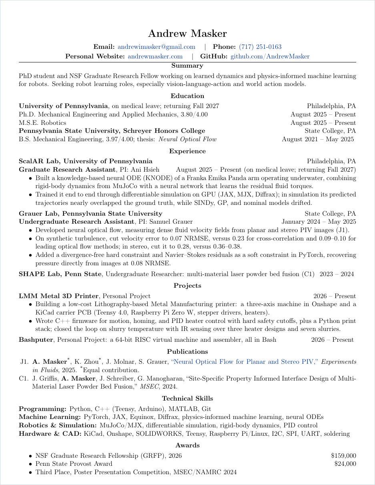

# Andrew Masker — CV / Resume

**Robotics resume (one page):** [Download PDF](https://raw.githubusercontent.com/AndrewMasker/CV_Resume_AIM/build/resume.pdf) · [View on GitHub](https://github.com/AndrewMasker/CV_Resume_AIM/blob/build/resume.pdf)

**Robotics resume (two pages):** [Download PDF](https://raw.githubusercontent.com/AndrewMasker/CV_Resume_AIM/build/resume_two_page.pdf) · [View on GitHub](https://github.com/AndrewMasker/CV_Resume_AIM/blob/build/resume_two_page.pdf)

**Academic CV:** [Download PDF](https://raw.githubusercontent.com/AndrewMasker/CV_Resume_AIM/build/cv.pdf) · [View on GitHub](https://github.com/AndrewMasker/CV_Resume_AIM/blob/build/cv.pdf)

## Layout

| File | Purpose |
| --- | --- |
| `resume.tex` | One-page robotics / robot learning resume, the main version (set as Overleaf's main document) |
| `resume_two_page.tex` | Two-page version of the robotics resume |
| `cv.tex` | Academic CV, oriented toward robot learning |
| `old_stuff.tex` | Previous full CV, kept for reference (not built by CI) |
| `preamble.tex` | Shared packages and page geometry |
| `sections/education.tex`, `sections/publications.tex` | Shared by every version |
| `sections/resume/*.tex` | Two-page resume sections (`skills` is also used by the CV) |
| `sections/resume/one-page/*.tex` | Condensed copies for the one-page resume; edit both when the content changes |
| `sections/cv/*.tex` | CV sections |
| `sections/old/*.tex` | Sections used only by `old_stuff.tex` |
| `CREDITS.md` | Where the LaTeX template came from, and its license |

To add another version, copy `resume.tex` or `cv.tex` to a new file,
keep, drop or swap `\input{sections/...}` lines as needed, and add the new
file to `root_file`, the artifact paths, and the publish step in
`.github/workflows/build.yml`. The preview image above shows `resume.tex`.

## Builds

Every push to `main` compiles the PDFs and force-pushes them, with a preview
image, to the `build` branch, which the links above point to. Pull requests
are compiled too; their PDF can be downloaded from the run's Artifacts.
Build output is kept off `main` so Overleaf's GitHub sync never pulls it in.
